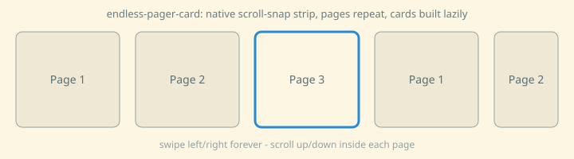

# Endless Pager Card



A Home Assistant dashboard card that lets you **swipe left and right between pages, endlessly**. Page 4 swipes on to page 1, and page 1 swipes back to page 4. Every page is any Lovelace card (or a stack of them) and **scrolls vertically on its own**.

* The horizontal motion is the **browser's own scroll-snap scrolling**: momentum, snapping and the feel of an iOS scroll view, running off the main thread.
* **Endless without a jump.** Instead of cloning pages and jumping back to the middle (which stutters on iOS), the strip is simply very long (about 200 slots, you start in the middle) and the cards are built lazily around the page you are on.
* **Vertical scrolling is native too.** A page whose content fits is *locked* (no vertical drag, no rubber band); a page that is taller scrolls normally.
* Remembers the page when you leave the dashboard tab and come back (Home Assistant detaches the card when you switch tabs).

Originally built for a phone remote-control dashboard (aircon / lights / TV / projector pages) and tested on an iPhone with the Home Assistant Companion app.

## Install

HACS: search for **Endless Pager Card** in *HACS → Dashboard* and install it. Until it shows up in the search, add it by hand: *HACS → ⋮ → Custom repositories* → `https://github.com/1404423/endless-pager-card`, type **Dashboard**. Manual: copy `dist/endless-pager-card.js` to `<config>/www/` and add it as a dashboard resource (`/local/endless-pager-card.js`, type *JavaScript module*).

## Use

Put the card alone in a **panel** view (it positions itself under the Home Assistant header):

```yaml
views:
  - title: Remote
    type: panel
    cards:
      - type: custom:endless-pager-card
        pages:
          - type: vertical-stack        # page 1: any card, or a stack of cards
            cards:
              - type: tile
                entity: light.living_room
              - type: markdown
                content: Hello
          - type: entities              # page 2
            entities: [switch.a, switch.b]
          - type: markdown              # page 3
            content: Another page
```

| Option | Default | Meaning |
|---|---|---|
| `pages` | (required) | List of card configurations, one per page |
| `loop` | `true` | Endless paging. `false` = a normal strip with two ends |
| `top` | `calc(56px + env(safe-area-inset-top, 0px))` | Where the pager starts (below the Home Assistant header) |
| `slots` | `200` | Length of the strip when looping (about this many slots; you start in the middle) |
| `build_radius` | `3` | Cards are built for the slots within this distance of the current one |
| `keep_radius` | `8` | Cards farther away than this are dropped again (frees memory) |
| `debug` | `false` | Shows a small panel with slot, cards alive, scroll position (useful when reporting a problem) |

A page's own `position: absolute` titles (some cards use them) are anchored to the page, so every page keeps its own title.

## How it works (and why)

Earlier approaches I tried on an iPhone, and what went wrong:

1. *JS-positioned pages (transforms):* the horizontal motion is driven from the main thread, so it never felt like a native scroll view.
2. *Native scroll-snap with cloned end pages and a jump back to the middle:* a visible hitch at the jump, and consecutive swipes ran into the end of the strip.
3. *Re-ordering pages with CSS `order` between swipes:* better, but still moves the scroll position at the wrong moments.

What works: a **long native strip** (page *i* is at slots *i*, *i+n*, *i+2n*…), real cards **only near the viewport** (created while your finger is up), far ones dropped, and nothing touching `scrollLeft` while you swipe. A safety jump back to the middle exists only for someone who swipes ~100 pages in one direction; it runs when idle and is invisible (the slots show the same page).

For vertical scrolling every page is its own scroll container with `touch-action: pan-x pan-y`; pages that fit get `overflow-y: hidden; touch-action: pan-x`. The decision uses the browser's own overflow numbers (a card's bounding box can be shorter than its content, so measuring the card is wrong).

Things worth knowing if you build something similar: Home Assistant detaches and re-attaches cards when you switch dashboard tabs (the browser then resets the scroll position to 0), and `ResizeObserver` does not fire on a re-attach with the same size, so the card re-positions itself on `connectedCallback`.

## Limits

* Tested on iPhone (Companion app) and in a Chromium test harness; **not tested on Android or other browsers**.
* About 100 pages in one direction without stopping, then the safety jump (invisible). `loop: false` gives a normal strip.
* Cards are built lazily: an extremely fast swipe can show an empty page for a moment.
* Use it in a `panel` view; it positions itself with `position: fixed` under the header.

## Try it without Home Assistant

Open `docs/demo.html` in a browser (phone-sized window) from a local web server, e.g. `python3 -m http.server` in this folder. `tests/logic.test.html` runs an automated check of the looping logic.

## Alternatives

[simple-swipe-card](https://github.com/nutteloost/simple-swipe-card) and [swipe-card](https://github.com/bramkragten/swipe-card) are established swipe cards with more features (autoplay, pagination styles, ...).

As far as I could tell from their documentation, simple-swipe-card's infinite loop is JavaScript-driven (it duplicates cards), and its native CSS scroll-snap mode disables looping. swipe-card is built on Swiper.js. This card fills that gap: endless paging on native scroll-snap, with native vertical scrolling inside each page. It is small and simple by design.

## About this project

Written with the help of an AI assistant (Claude) and tested on real hardware by the author. Issues and pull requests are welcome.

## License

[MIT](LICENSE)

---

## 日本語

Home Assistant のダッシュボード用カードです。**左右にスワイプして、ページを無限に切り替えられます**(4 ページ目から次へ進むと 1 ページ目、1 ページ目から戻ると 4 ページ目)。各ページには、好きなカード(複数をまとめたものも可)を置け、ページごとに**縦スクロール**できます。

* 横の動きは、**ブラウザ標準のスナップ付きスクロール**です(慣性、ぴたっと止まる動き、iOS の自然な感触)。
* **ジャンプなしの無限**:ページの複製や、真ん中への飛び移り(iPhone でカクつきます)は使いません。約 200 ページ分の長い列を作り、真ん中から始め、**今いるページの近くのカードだけ**を、その都度作ります。
* **縦スクロールも標準**:画面に収まるページは縦に動かず(ゴムのような動きもなし)、長いページは普通にスクロールします。
* ダッシュボードのタブを離れて戻っても、**最後のページを覚えています**。

スマホのリモコン画面(エアコン、照明、テレビ、プロジェクター)用に作り、iPhone の HA コンパニオンアプリで確認しています。

### 使い方
HACS の「カスタムリポジトリ」に `https://github.com/1404423/endless-pager-card` を、種類「ダッシュボード」で追加して、インストールします。**パネル表示**のビューに、このカードだけを置き、`pages` に各ページのカードを並べます(上の YAML を参照)。

### 注意
* iPhone と、パソコンのブラウザでの試験のみです。**Android は未確認**です。
* とても速いスワイプでは、作成が間に合わず、一瞬、空のページが見えることがあります。
* AI アシスタント(Claude)の助けを借りて作り、実機で確認しています。
